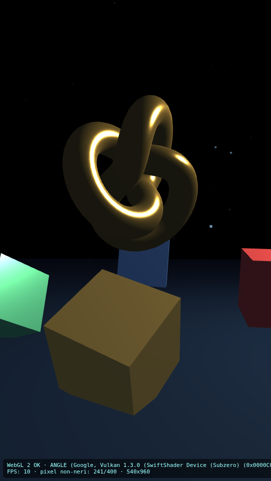

# WebGL Test Suite — let an AI agent really SEE your WebGL/Three.js games

Run real browser tests of WebGL games on a **remote runner** (GitHub Actions) or a **PC on your LAN**, collect **real screenshots**, and let an AI agent look at them. No local models required: the AI stays on API/cloud, only the browser moves to a machine where it works.

Built for environments where Chromium can't run locally (no GPU, sandboxed/PRoot devices, blocked downloads). A Canvas 2D fallback never counts as a WebGL success.

## What you get

- **WebGL 1 and WebGL 2 probed separately**: version + actual renderer. Software rendering (SwiftShader) is always **declared** — it is not the player's GPU performance.
- **Movement proof**: two screenshots 2.5 s apart + pixel diff → automatic check that the scene is animated (not just "a canvas exists").
- **Scenario runner**: taps, clicks, keys, waits, visibility asserts, screenshots of key moments (menu, countdown, gameplay, pause, resume, results…).
- **Console errors** and **off-screen elements** collected.
- **Spector.js** (optional): draw calls, commands and stats of a captured frame.
- **Honest reports**: automatic checks / visual verification / not executed — separated. A test never passes without real images.
- Viewports: **360×640**, **540×960** (9:16 mobile), **1280×720** (desktop).
- Your game code is never modified: scenarios only drive input and read the DOM.

## Use it as a plugin in your agent (skill / MCP server)

- **Skill** (`skill/SKILL.md`): copy it into your client's skills folder — instructions and
  install commands in [`mcp-server/README.md`](mcp-server/README.md).
- **MCP server** (`mcp-server/server.js`, zero dependencies): tools `webgl_test` and
  `webgl_diff` for any MCP client (Claude, Codex, Cursor, …). Config examples included.
- **Reusable CI**: the workflow also runs on this repo's demo by default — fork and go.

## Example result (real, from the included Three.js demo)



> WebGL 2 OK · animated scene (21% pixels changed between two shots) · full report in [`examples/demo/report.html`](examples/demo/report.html) · raw data in [`examples/demo/report.json`](examples/demo/report.json)

## Route 1 — GitHub Actions (zero local browser needed)

The workflow `.github/workflows/test-webgl.yml` runs Chromium on a real Ubuntu runner (SwiftShader on CPU, declared in the report) and uploads screenshots + report as artifacts.

```sh
# 1. Fork/clone this repo and push it to your GitHub account
# 2. For private game repos: set the secret GH_GAME_TOKEN (a read-only PAT)
gh secret set GH_GAME_TOKEN --body "<your-read-only-pat>"

# 3. Run against your game (owner/repo)
gh workflow run test-webgl.yml -f game_repo=owner/your-game -f game_dir=. -f viewport=540x960

# …or against the included demo scene (defaults)
gh workflow run test-webgl.yml

# 4. Watch, then download and LOOK at the screenshots
gh run watch
gh run download
# open report-webgl-540x960/report.html in a browser
```

Scenarios live in `scenari/*.json` in this repo. For private games you can pass the scenario **inline**, without committing it:

```sh
gh workflow run test-webgl.yml -f game_repo=owner/private-game -f game_dir=. \
  -f scenario_inline="$(cat my-scenario.json)"
```

## Route 2 — MCP: agent drives a real browser on your PC (vision)

Config and guide in [`mcp/README-MCP.md`](mcp/README-MCP.md):

- **Playwright MCP** with `--vision` on the PC → the agent gets `browser_*` tools and looks at real frames (client config examples: `mcp/clienti-esempio.json`).
- **Chrome DevTools MCP** over an SSH tunnel for debugging/profiling.
- LAN-only ports, no public DevTools endpoints, no credentials in URLs.
- `mcp/spector-snippet.js`: evaluate it in an interactive session to capture frames with Spector.js.

## Scenario format

```json
{
  "nome": "my-game-smoke",
  "passi": [
    { "azione": "attendi", "ms": 3000 },
    { "azione": "screenshot", "nome": "01-menu" },
    { "azione": "clicca", "selettore": "#play" },
    { "azione": "tocca", "x": 270, "y": 824 },
    { "azione": "tasto", "tasto": "Escape" },
    { "azione": "assert-visibile", "selettore": "#hud" },
    { "azione": "screenshot", "nome": "02-corsa" },
    { "azione": "tocca", "x": 100, "y": 700, "da_tarare": true, "nota": "da calibrare: finisce in 'non eseguiti'" }
  ]
}
```

Tip: on slow software rendering, selector clicks can hit actionability timeouts — a coordinate `tocca` (real tap) often works better. Steps marked `da_tarare` are honestly reported as *not executed*.

## Local runner (when a working browser exists: PC, phone, CI)

```sh
npm i playwright && npx playwright install --with-deps chromium
pip install pillow
node scripts/testa-ci.js path/to/game --vp 540x960 --scenario scenari/esempio.json --spettro
node scripts/testa.js path/to/game --vp 1280x720        # quick FPS + pixel check
```

## Limits

- SwiftShader = software rendering on CPU: great for **seeing and verifying**, not for **benchmarking**. For real performance use Route 2 with a GPU browser.
- The included demo (`demo/scena.html`, Three.js r128 vendored) is a smoke test for the channel itself.
